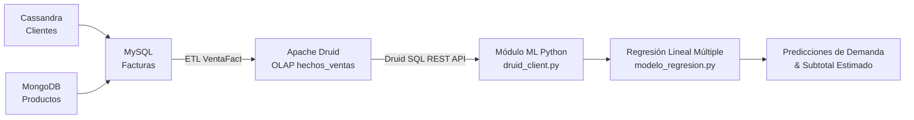

# Módulo de Machine Learning - Apache Druid & Regresión Lineal Múltiple

Este módulo implementa el componente analítico y predictivo del proyecto de Facturación con Arquitectura Hexagonal y Persistencia Políglota.

---

## 1. Justificación y Selección del Modelo

- **Modelo Utilizado**: **Regresión Lineal Múltiple** (`LinearRegression` con *Scikit-Learn*).
- **¿Por qué este modelo?**:
  - Cumple directamente con la sugerencia docente para trabajar de forma **100% local**, consumiendo menos de **100 MB de RAM**, sin requerir tarjetas gráficas (GPU) ni clusters en la nube.
  - Ofrece **interpretabilidad matemática total**: a diferencia de las redes neuronales ("cajas negras"), la regresión lineal múltiple entrega coeficientes beta ($\beta$) claros que explican cuantitativamente cómo cada característica (categoría de cliente, producto, precio) incrementa o reduce la demanda.

---

## 2. Flujo de Datos en la Arquitectura



1. **Persistencia Políglota Operacional**:
   - **Cassandra**: Gestión de personas y clientes (`clienteDocumento`, `clienteCategoria`, `clienteCiudad`).
   - **MongoDB**: Catálogo de productos (`productoId`, `costo`, `precio`).
   - **MySQL**: Registro transaccional de facturas y detalles.
2. **Respaldo Analítico en Apache Druid**:
   - El servicio Spring Boot `GenerarHechosService` extrae las facturas de MySQL, las enriquece con Cassandra y MongoDB, y emite eventos `VentaFact` a Apache Druid en el datasource `hechos_ventas`.
3. **Extracción y Aprendizaje**:
   - El script `druid_client.py` consulta Druid mediante su API SQL (`POST /druid/v2/sql`). Si Druid no estuviese encendido, dispone de un generador simulado alineado al modelo de datos para garantizar continuidad operativa y presentaciones sin contratiempos.
   - El modelo de regresión codifica las variables categóricas (One-Hot Encoding) y entrena los pesos $\beta$.

---

## 3. Formulación Matemática del Modelo

$$Y = \beta_0 + \beta_1 X_1 + \beta_2 X_2 + \dots + \beta_k X_k + \epsilon$$

Donde:
- **Variable Objetivo ($Y$)**: `cantidad` (Unidades estimadas que el cliente comprará).
- **Intercepto base ($\beta_0$)**: Cantidad base esperada para la categoría de referencia.
- **Variables Predictoras ($X_i$)**:
  - Variables categóricas codificadas (One-Hot Encoding): `clienteCategoria` (`MAYORISTA`, `DISTRIBUIDOR`, `CORPORATIVO`, `MINORISTA`, `OCASIONAL`), `clienteCiudad`, `productoNombre`.
  - Variables cuantitativas continuas: `precioUnitario`, `costoUnitario`.

### Interpretación de Coeficientes Aprendidos:
- **$\beta_{\text{DISTRIBUIDOR}} \approx +38.9$**: Ser distribuidor incrementa la compra promedio en casi 39 unidades sobre la base.
- **$\beta_{\text{MAYORISTA}} \approx +14.8$**: Ser mayorista incrementa la compra en ~15 unidades.
- **$\beta_{\text{MINORISTA}} \approx -16.9$**: Ser minorista contrae la compra en ~17 unidades respecto al promedio de referencia.
- **$\beta_{\text{precio}}$**: Capta la elasticidad precio de la demanda.

---

## 4. Instrucciones de Ejecución

### Prerrequisitos:
Tener Python 3.10+ instalado. Las librerías necesarias son:
```bash
pip install -r ml/requirements.txt
```

### Ejecutar Demostración por Consola (CLI):
```bash
python ml/run_ml.py
```
Este script:
1. Conecta con Druid (o usa el fallback inteligente de hechos OLAP).
2. Entrena el modelo de Regresión Lineal Múltiple.
3. Imprime las métricas de rendimiento ($R^2$, MAE, RMSE).
4. Imprime la ecuación matemática aprendida con sus coeficientes.
5. Genera la gráfica de diagnóstico en `ml/graficas/evaluacion_modelo.png`.
6. Ejecuta 4 casos prácticos de predicción de demanda en vivo.

### Ejecutar Microservicio API REST (Opcional):
```bash
python ml/api_service.py
```
Servicio en `http://localhost:5000`:
- `GET /api/ml/status` : Estado del modelo y métricas.
- `POST /api/ml/predict` : Recibe JSON con atributos del cliente y producto, y retorna la cantidad y subtotal predicho.
- `GET /api/ml/grafica` : Descarga la imagen con las gráficas de evaluación.
